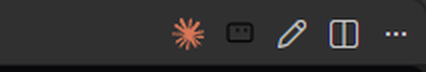
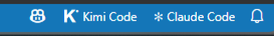
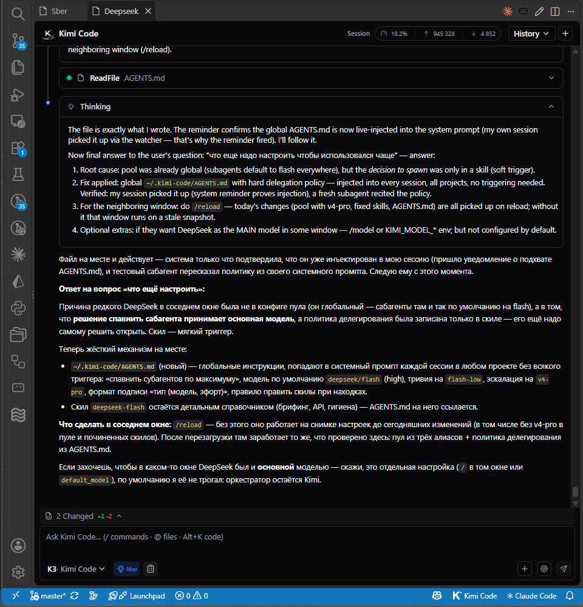

# Kimi Code Companion

Локальное расширение VS Code (`lekra.kimi-companion`). Дополняет официальное расширение Kimi Code (`moonshot-ai.kimi-code`) возможностями, которых в нём нет:

- **восстановление окон Kimi после «Developer: Reload Window»** — с их названиями, колонкой редактора и **историей диалога**;
- **кнопки**: значок Kimi в заголовке редактора (новое окно), карандаш рядом с ним (переименовать окно), значок списка (открытые чаты) и «K Kimi Code» в статус-баре справа;
- **переименование окон** Kimi (`Kimi Code: Rename Window`) — введённое вручную название сохраняется и переживает перезагрузку, а автоназвание больше его не заменяет;
- **окна с названием проекта** — окно, открытое компаньоном (кнопка, `Ctrl+Alt+K`, меню), сразу называется по текущей рабочей области, а не «Kimi Code»;
- **автоназвание окон по теме диалога** (только пока окно носит стандартное название «Kimi Code»: берётся `title`/`lastPrompt` из `state.json` сессии; имя проекта и пользовательские названия сохраняются);
- **«Kimi Code: Reopen Closed Window»** — переоткрывает последнее закрытое окно (помнит до 5); если переоткрыть не удалось, запись остаётся в истории и попытку можно повторить;
- **«Kimi Code: Open Chats»** — живой список открытых чатов Kimi с поиском: сначала чаты, ждущие ответа, затем с ошибкой, затем остальные в порядке вкладок; поиск остаётся штатным (список не сужается, запрос сохраняется при живом обновлении), а выбранный чат перед показом сверяется с живым списком; доступен также из заголовка редактора и из меню статус-бара;
- **«Kimi Code: Next Waiting Chat»** / **«Kimi Code: Next Chat Needing Attention»** — показать следующий ждущий чат (или следующий чат из ждущих и с ошибкой), с переходом по кругу; если чат исчез, цикл начинается заново;
- **счётчик `[? N]`** в статус-баре — сколько чатов Kimi ждут ответа; виден только пока N > 0, клик открывает следующий ждущий чат;
- **«Kimi Code: Usage»** — текущая квота подписки (лимиты 5 ч / 7 дней / месяц и booster-кошелёк) отдельным отчётом, с темпом расхода, прогнозом исчерпания и обратным отсчётом до сброса;
- **баланс DeepSeek в отчёте Usage и в тултипе статус-бара** (ключ из секции `[providers.deepseek]` конфига Kimi Code; настройка `kimiCompanion.deepseekBalance`, по умолчанию включена);
- **пороговые уведомления** — нативные уведомления VS Code с защёлкой на окно: 5-часовое окно при ≥ 80%, месячный лимит при ≥ 90%, баланс DeepSeek ниже $1 (настройки `kimiCompanion.alerts`, `kimiCompanion.alertThreshold5h`, `kimiCompanion.alertThresholdMonth`, `kimiCompanion.alertDeepseekBelowUsd`); срабатывают, даже когда процент скрыт из статус-бара, и взводятся заново после сброса лимита или падения расхода ниже порога;
- **звук и уведомление о завершении хода** — по умолчанию короткий звуковой сигнал, а нативное уведомление с названием окна можно включить отдельно (настройки `kimiCompanion.tabCompletionNotification`, `kimiCompanion.tabCompletionSound`);
- **статусы в названии вкладки** — перед названием окна показывается его состояние: `[~]` работа идёт, `[V]` выполнено, `[!]` ошибка, `[?]` ждёт вашего ответа или подтверждения (`kimiCompanion.tabStatusMarkers`);
- **использование квоты в статус-баре** — два значения: сначала месячный лимит, затем 5-часовое окно, плюс баланс бустер-кошелька (например, `M 16% · 5h 82% · 💳 $12.34`), обновляются раз в 5 минут (настройка `kimiCompanion.usageInStatusBar`); статус-бар краснеет, когда короткое окно (≤ суток) достигает порога `kimiCompanion.alertThreshold5h` (по умолчанию 80%) и данные свежие; устаревшие данные помечаются `⚠ stale` / `↻ refresh needed`; при наведении на кнопку открывается богатая панель в стиле Copilot — по каждому лимиту заголовок с датой сброса, крупный процент и графическая полоска прогресса (настоящее изображение, генерируется на лету; красная при том же пороге), строка темпа и прогноза, бустер-кошелёк и баланс DeepSeek, а внизу — кликабельные ссылки-действия (отчёт по лимитам, новое окно);
- **меню в статус-баре** — клик по кнопке открывает меню с действиями (Обновить лимиты, Новое окно, Вернуть закрытое окно, Открытые окна) и списком открытых окон с фокусом по выбору; пункт «Открытые окна» открывает список с поиском, описанный выше; лимиты в меню не дублируются — они показаны в статус-баре, его подсказке и отчёте `Kimi Code: Usage`; пункт «Обновить лимиты» перечитывает данные и заново открывает меню; меню и подсказка локализованы на язык интерфейса VS Code (en / ru / zh-cn; фразы темпа остаются английскими);
- **`Ctrl+Alt+K`** (`Cmd+Alt+K` на Mac) — новое окно Kimi;
- **«Kimi Code: Diagnostics»** — отчёт о состоянии: версии, все 12 врезок, последняя операция с врезками и сведения о резервной копии, хуки, окна, сохранённое состояние;
- **«Kimi Code: Check Compatibility»**, **«Kimi Code: Install / Repair Patches»**, **«Kimi Code: Restore Original Files»** — проверка по манифесту и транзакционная установка врезок для Kimi Code **0.8.2**, **0.8.3** и **0.8.4**; неизвестная версия Kimi не патчится;
- восстановление истории в **сайдбаре** Kimi.

Лог работы: Вид → Вывод → канал **«Kimi Code Companion»**.

## Скриншоты

*Кнопки в заголовке редактора*

*Кнопка в статус-баре с процентом использования*

*Восстановленные окна с названиями и историей*

## Почему нужны врезки в код Kimi

VS Code не даёт одному расширению доступа к webview-панелям другого (ни заголовок сменить, ни сессию узнать). Поэтому компаньон вносит маленькие правки в `dist` расширения Kimi — они регистрируют окна и хуки в `globalThis` (общая область процесса extension host).

## Врезки (13 штук), файл `moonshot-ai.kimi-code-*/dist/`

| # | Файл | Маркер | Что делает |
|---|------|--------|------------|
| 1 | extension.js | `__kimiCompanionNextTitle` | заголовок новой вкладки берётся из `globalThis.__kimiCompanionNextTitle` |
| 2 | extension.js | `/*__kimiCompanion__*/` | созданные панели кладутся в `globalThis.__kimiCompanionPanels` (+удаление при dispose) |
| 3 | extension.js | `__kimiCompanionNextColumn` | колонка новой вкладки из `globalThis.__kimiCompanionNextColumn` |
| 4 | extension.js | `/*__kimiCompanion2__*/` | хуки `__kimiCompanionGetSessionId / GetWebviewId / LoadSession` |
| 5 | extension.js | `__kimiCompanionGetSidebarId` | хук поиска webviewId сайдбара |
| 6 | webview.js | `__kimiCompanionLoadSessionInUi` | обработчик события `__kimiCompanionLoadSession` в вебвью — штатный `loadSessionHistory → loadSession` |
| 7 | extension.js | `__kimiCompanionGetUsage` | хук квоты подписки через `harness.auth.getManagedUsage` — основной путь; запасной — прямой HTTPS-запрос с локальными учётными данными |
| 8 | extension.js | `/*__kimiCompanionTurnSettled__*/` | терминал хода (`emitTerminal`) отдаётся в `globalThis.__kimiCompanionTurnSettled` — уведомление о завершении во вкладке |
| 9 | extension.js | `__kimiCompanionTurnStarted` | старт промпта (`this.activePrompt = active`) отдаётся в `globalThis.__kimiCompanionTurnStarted` — статус `[~]` |
| 10 | extension.js | `/*__kimiCompanionWaitA__*/` | обработчик подтверждений обёрнут: ожидание/ответ отдаются в `globalThis.__kimiCompanionWaiting` — статус `[?]` |
| 11 | extension.js | `/*__kimiCompanionWaitQ__*/` | та же обёртка на обработчике вопросов — статус `[?]` |
| 12 | extension.js | `/*__kimiCompanionPromptSettled__*/` | любое завершение промпта (`settlePrompt`) сообщается в `globalThis.__kimiCompanionPromptSettled` — снимает `[~]`/`[?]`, когда промпт закончился без терминала хода (ошибка до старта, ранняя ошибка, закрытие сессии) |
| 13 | extension.js | `__kimiCompanionSessionTitles` | история Kimi показывает актуальный заголовок вкладки из `globalThis.__kimiCompanionSessionTitles` вместо автоназвания сессии, если переопределение доступно |

Единственный якорь, который сдвинулся между этими релизами, — врезка в вебвью: в 0.8.2/0.8.3 хранилище истории сессий в бандле называется `Qe`, а в 0.8.4 его переименовали в `Ve`. Поэтому у компаньона по одному варианту этого якоря на форму бандла, и вариант выбирается по версии Kimi.

**Самолечение:** при каждой активации компаньон выполняет операцию установки. Для поддерживаемой версии он сверяет `dist` с манифестом и доставляет только недостающее (например, после обновления Kimi); если байты не совпадают ни с одним известным состоянием (оригинал, патч, доказанная промежуточная стадия), ничего не пишется, а в предупреждении названа причина. Если якорь в новой версии Kimi не находится — таблица выше служит руководством для правки.

## Проверка, резервная копия и команды

Компаньон патчит только ту версию Kimi Code, которая есть в `resources/patch-manifest.json` (схема 1). Сейчас это **0.8.2**, **0.8.3** и **0.8.4**: для обоих файлов `dist` в манифесте записаны SHA-256 и размер оригинального и пропатченного файла, а также отпечаток врезок, выбранных для этой версии (у 0.8.4 он свой — из-за якоря вебвью выше).

Каждая установка и каждый откат транзакционны:

- файл-замок в каталоге резервных копий сериализует операции (замок процесса, которого уже нет, или замок старше 10 минут снимается);
- файлы пишутся через временный файл, `fsync` и переименование, поэтому прерванная операция оставляет прежний файл целым, а не половину нового;
- результат проверяется до записи (каждый якорь встречается ровно один раз, пропатченный текст разбирается) и после записи (хеши файлов, все тринадцать маркеров, разбор);
- при любой ошибке возвращаются ровно прежние байты; файл, изменённый другим процессом уже после записи, сохраняется и попадает в отчёт, а не перезаписывается.

**Неизвестная версия Kimi не патчится**: операция сообщает `state: unknown`, ничего не пишет, и хуки остаются недоступны, пока в манифесте не появится запись для этой версии. `dist`, не совпадающий ни с одним известным состоянием, отклоняется так же.

Оригиналы хранятся в `globalStorage` компаньона: `…/User/globalStorage/lekra.kimi-companion/patches/<версия Kimi>/` — файлы `extension.js`, `webview.js` и `backup.json` как маркер завершённости (недописанная копия без маркера игнорируется). Откат использует эти файлы, только если каждый байт совпадает с хешем из манифеста. Старые файлы `*.bak-kimi-companion` рядом с `dist` больше не создаются; они читаются только при совпадении хеша с манифестом — чтобы перенести их в это хранилище или восстановить из полного проверенного набора.

Команды:

- **«Kimi Code: Check Compatibility»** — разбирает `dist` и резервную копию, ничего не записывая, и открывает отчёт диагностики с состоянием врезок, найденными проблемами и сведениями о копии;
- **«Kimi Code: Install / Repair Patches»** — доставляет недостающие врезки; если файлы изменились, предлагает перезагрузку, а если состояние нельзя пропатчить безопасно — предупреждает, ничего не записывая;
- **«Kimi Code: Restore Original Files»** — спрашивает подтверждение (кнопка в диалоге — `Restore Original Files`), возвращает проверенные оригиналы и предлагает перезагрузку. Нужна проверенная резервная копия; без неё команда предупреждает и не трогает `dist`.

## Версия Kimi запиннена

В `~/.vscode/extensions/extensions.json` у `moonshot-ai.kimi-code` стоит `"pinned": true` — автообновление выключено, чтобы врезки не слетали в случайный момент. **Обновление Kimi — только осознанно**: снять пин → обновить → выполнить **«Kimi Code: Check Compatibility»** → при расхождении поправить врезки по таблице выше → перезагрузить окно. Версия, которой нет в манифесте, будет показана как неизвестная и останется нетронутой, а возможности компаньона будут недоступны, пока манифест её не покроет.

## Откат / удаление

1. Выполнить **«Kimi Code: Restore Original Files»** и подтвердить. Перезагружать окно пока не нужно — пока компаньон установлен, его следующая активация снова внесёт врезки.
2. Удалить это расширение.
3. Перезагрузить окно.

Ручной запасной путь, если команда недоступна (например, компаньон уже удалён): скопировать `extension.js.bak-kimi-companion` поверх `extension.js`, а `webview.js.bak-kimi-companion` поверх `webview.js` в `dist` расширения Kimi. Либо удалить папку `moonshot-ai.kimi-code-*` и поставить расширение заново с маркетплейса. Затем перезагрузить окно.

## Настройки

- `kimiCompanion.restoreTabOnStartup` (по умолчанию `true`) — восстанавливать окна после перезагрузки и сохранять снимок окон, пока настройка включена (при выключении сохранённый снимок остаётся нетронутым);
- `kimiCompanion.tabCompletionNotification` (по умолчанию `false`) — нативное уведомление о завершении хода Kimi в окне (вкладке);
- `kimiCompanion.tabCompletionSound` (по умолчанию `true`) — встроенный звуковой сигнал при том же завершении (только в настольной версии);
- `kimiCompanion.tabStatusMarkers` (по умолчанию `true`) — префикс `[~]` / `[V]` / `[!]` / `[?]` в названии окон Kimi;
- `kimiCompanion.statusBarButton` (по умолчанию `true`) — кнопка в статус-баре;
- `kimiCompanion.usageInStatusBar` (по умолчанию `true`) — показывать процент использования квоты подписки в статус-баре;
- `kimiCompanion.deepseekBalance` (по умолчанию `true`) — читать баланс DeepSeek ключом из конфига Kimi Code и показывать его в отчёте и тултипе; при выключении запрос не выполняется и пороговое уведомление о низком балансе не срабатывает;
- `kimiCompanion.alerts` (по умолчанию `true`) — нативные уведомления при пересечении порога расхода (один раз за окно лимита; не требует `usageInStatusBar`);
- `kimiCompanion.alertThreshold5h` (по умолчанию `0.8`) — порог уведомления для 5-часового окна (доля `0..1`);
- `kimiCompanion.alertThresholdMonth` (по умолчанию `0.9`) — порог уведомления для месячного лимита (доля `0..1`);
- `kimiCompanion.alertDeepseekBelowUsd` (по умолчанию `1`) — предупреждать, когда баланс DeepSeek опускается ниже этой суммы (USD).

Пороги — доли; процент, введённый вручную (`80`), читается как `0.8`, а не отключает уведомление.

## Сохранённое состояние и несколько окон

Открытые окна (название, колонка редактора, сессия) и сессия сайдбара сохраняются в состоянии рабочей области; закрытые окна ведутся отдельной историей до 5 записей.

В каждый момент снимком владеет одно окно. Аренда лежит в `globalStorage` компаньона (`window-restore.lease`), продлевается каждые 5 с и считается брошенной через 15 с; при деактивации владеющего окна она освобождается. **Снимок восстанавливает и записывает только владелец аренды — все остальные окна оставляют его без изменений** и не записывают в него свои окна.

Сохранённое состояние не перезаписывается, если его нельзя безопасно восстановить:

- настройка `kimiCompanion.restoreTabOnStartup` выключена;
- хуки недоступны (версия Kimi не пропатчена или неизвестна);
- текущая активация только что внесла врезки и перезагрузка ещё не выполнена;
- арендой владеет другое окно;
- восстановление не удалось (окно не открылось или диалог не привязался).

Тогда следующая перезагрузка повторит попытку с тем же снимком.

Восстанавливаются название, колонка редактора и диалог. Не восстанавливаются живые статусы вкладок (они вычисляются заново после перезагрузки) и неотправленный ввод — черновики по вкладкам не сохраняются.

## Данные о расходе и их свежесть

`Kimi Code: Usage` и статус-бар читают квоту сначала через хук Kimi (`harness.auth.getManagedUsage`), а при неудаче — прямым HTTPS-запросом с локальными учётными данными; каждый прямой запрос обрывается через 12 с, а обращения во время уже идущего обновления сливаются в одно повторное чтение, поэтому зависший сервер не блокирует таймер и не размножает уведомления. Снимок помечается `stale`, если он старше 2 минут (или получен «из будущего»), и `refresh-needed`, если время сброса какого-то лимита уже прошло; когда процент показывается, в статус-баре добавляется `⚠ stale` / `↻ refresh needed`, а красная подсветка ставится только по свежим данным. Пороговые уведомления проверяются независимо от `kimiCompanion.usageInStatusBar`.

## Грабли, которые уже выловлены

- Манифест врезок покрывает только Kimi Code **0.8.2**, **0.8.3** и **0.8.4**; любая другая версия показывается как неизвестная и остаётся нетронутой, поэтому зависящие от врезок возможности недоступны, пока манифест её не покроет.
- **Кэш расширений** `~/.vscode/extensions/extensions.json` — при ручном переименовании/переносе папки расширения запись в кэше надо править синхронно (location, relativeLocation, version), иначе после перезагрузки расширение «исчезает» с ENOENT.
- Monkey-patch `vscode.window.*` из своего расширения **не действует** на чужие: у ESM-расширения (Kimi) свой экземпляр API. Поэтому вместо перехвата — врезки + `globalThis`.
- `tab.input.viewType` webview-вкладки Kimi ≠ `"kimiPanel"` (проверено на 1.139.1) — для детекции вкладок полагаться нельзя, используется реестр панелей.
- После правок `dist` Kimi проверять синтаксис: `node --check extension.js` (ESM) и `node -e "new (require('vm').Script)(...)"` для webview.js (script).
- История восстанавливается в окнах-вкладках и в сайдбаре; окно с совершенно новым пустым диалогом восстановится пустым (с названием); если диалог удалён из списка сессий, его окно восстановится пустым.
- Несколько окон: снимок восстанавливает и записывает только владелец аренды; остальные окна оставляют его без изменений, поэтому их названия, колонки и история не записываются, пока арендой владеет другое окно.
- Список открытых чатов и счётчик `[? N]` знают только окна Kimi, открытые в текущем окне VS Code.
- Статусы и счётчик отражают события с момента активации: после перезагрузки статусы не восстанавливаются, черновики и неотправленный ввод по вкладкам не сохраняются.
- «Kimi Code: Restore Original Files» возвращает проверенные оригиналы, но пока компаньон установлен, его следующая активация снова внесёт врезки; используйте команду непосредственно перед удалением или для диагностики.
- Уведомление о завершении хода срабатывает только для нормально завершённого хода в открытой вкладке Kimi; сайдбар, отменённые и упавшие ходы, фоновые и исторические — молчат.
- Встроенный сигнал (`resources/completion.wav`) проигрывается через PowerShell `SoundPlayer` на Windows, `afplay` на macOS и `paplay` на Linux (отсутствие проигрывателя — тишина); в web- и remote-сессиях звука нет.
- Надёжного API, чтобы мигнуть конкретным окном VS Code, нет — мигание окна не реализовано.
- Значки в статус-баре одноцветные (ограничение VS Code), поэтому синяя точка логотипа «K» там монохромная.
